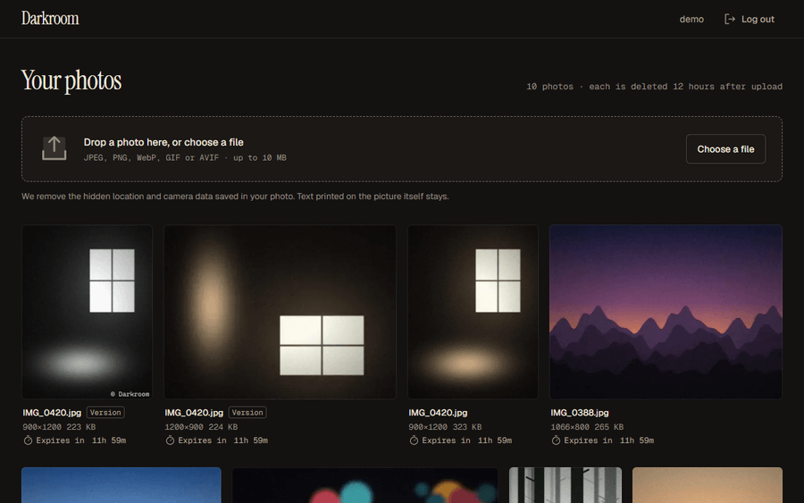
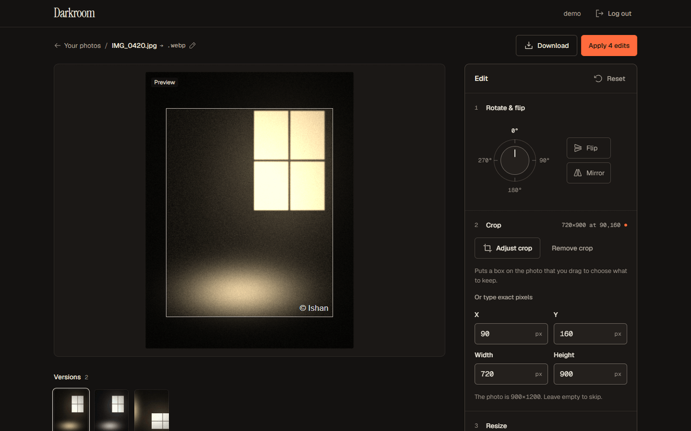
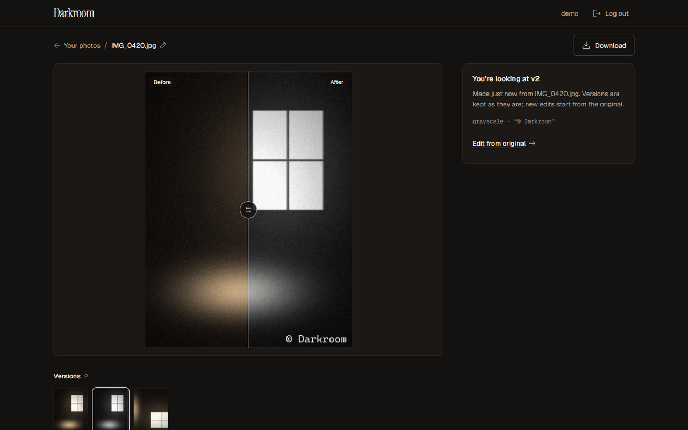
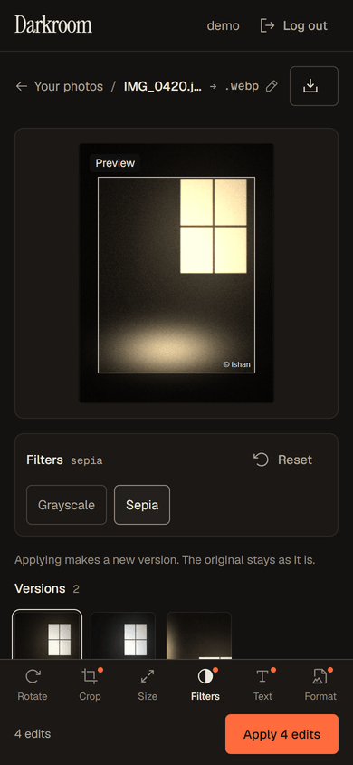

# Darkroom

A photo editor that runs in your browser and does the real work on a server. Upload a photo; rotate, crop, resize, filter, watermark and convert it with a live preview; apply once; download the result.

**Live: [darkroom-ishan.vercel.app](https://darkroom-ishan.vercel.app)** · [](https://github.com/zeroTwoishan/image-processing-service/actions/workflows/ci.yml)



> The API runs on Render's free plan and sleeps after 15 idle minutes, so the first request can take about a minute.

This is the [Image Processing Service](https://roadmap.sh/projects/image-processing-service) project from roadmap.sh: a small Cloudinary, with an Express + MongoDB API and a React frontend.

## What it does

- **Edits stay non-destructive.** The original is never changed: each Apply saves a new *version*, and the before/after view compares it with the original.
- **Live preview, one Apply.** Every edit previews instantly in the browser (CSS transforms and filters, a drag-to-crop box), and the server makes the real file only when you press Apply.
- **Rotate, flip, crop, resize, grayscale, sepia, text watermark,** and conversion to JPEG, PNG, WebP or AVIF with a quality setting.
- **Privacy:** location and camera data (EXIF/GPS) are removed on upload, and every photo and its versions are deleted 12 hours after upload.
- **Accounts:** sign up, a gallery with pages, rename in place, download, delete.
- **Works on phones:** the photo stays on screen while the tools switch underneath it.

| Editor (desktop) | Before / after | Editor (phone) |
| --- | --- | --- |
|  |  |  |

## How it works

```
Browser ── React (Vercel) ──HTTPS + JWT──> Express API (Docker on Render) ──┬──> MongoDB Atlas: users, photo metadata, transform cache
                                                                            └──> Supabase Storage (S3 API): the image files
```

One request, start to finish: **Apply** sends `POST /api/images/:id/transform` with the edits as JSON. The API checks the token, the per-user rate limit and the edits (Zod), then fingerprints *photo + edits* with sha256. If that version already exists it comes straight back. Otherwise Sharp builds it in a fixed pipeline (orient → rotate → flip → crop → resize → filters → watermark → encode), and the file, a thumbnail and a database row are saved.

Decisions worth a second look:

| Decision | Why |
| --- | --- |
| Mongo stores **storage keys**, never URLs | URLs are built from one setting when data is sent out, so the app moved storage providers four times with zero database changes. |
| One **storage interface** (`save` / `get` / `remove` / `list`) | Local disk in development, Supabase in production; a shared test runs against both. |
| **Unique partial index** on the cache key | Two identical requests at the same moment can't both save: the loser gets a duplicate-key error, deletes its files and returns the winner's version. |
| A **pure** `applyTransform(buffer, edits)` | No Express or database inside, so it's tested with bytes alone. |
| Cleanup deletes **files first, then rows** | A crash halfway leaves rows that still point at their files, so the next run finishes the job. A second sweep removes old files no row points to. |
| **Rate limits** per IP for login, per user for transforms | A shared college network shouldn't lock everyone out because one person is busy. |
| Public files with **random UUID names** | Images load in plain `` tags; nobody can guess a URL, and the bucket can't be listed. |
| Validated **settings at startup** | A missing setting stops the deploy with a clear message instead of failing a user's upload later. |

## API

All routes live under `/api`; every `/images` route needs `Authorization: Bearer <token>`. Errors always look like `{ "error": { "code", "message", "details?" } }`.

| Method | Path | Does |
| --- | --- | --- |
| `POST` | `/register`, `/login` | Create an account / log in → `{ user, token }`. 5 attempts a minute per IP |
| `GET` | `/me` | The logged-in user |
| `POST` | `/images` | Upload (multipart field `image`, ≤ 10 MB, ≤ 25 MP; JPEG, PNG, WebP, GIF, AVIF) |
| `GET` | `/images?page=1&limit=10` | Your photos, newest first, with `pagination` |
| `GET` | `/images/:id` | One photo plus its versions |
| `POST` | `/images/:id/transform` | `{ transformations }` → `201` new version, or `200` if it already exists. 10 a minute per user |
| `PATCH` | `/images/:id` | Rename (`{ name }`; the server adds the real extension) |
| `DELETE` | `/images/:id` | Delete a photo and its versions, or one version |
| `GET` | `/health/live`, `/health/ready` | Process up / database reachable |

```json
{ "transformations": {
    "rotate": 90, "flip": true, "mirror": false,
    "crop": { "x": 0, "y": 0, "width": 400, "height": 300 },
    "resize": { "width": 800, "height": 600 },
    "filters": { "grayscale": false, "sepia": true },
    "watermark": { "text": "@ishan" },
    "format": "webp", "compress": { "quality": 75 }
} }
```

Error codes: `VALIDATION_FAILED`, `INVALID_TRANSFORM`, `INVALID_CROP`, `TRANSFORM_ON_VERSION` (400), `UNSUPPORTED_FILE` (400), `FILE_TOO_LARGE` (413), `UNAUTHORIZED` (401), `NOT_FOUND` (404), `USERNAME_TAKEN` (409), `RATE_LIMITED` (429, with `Retry-After`), `INTERNAL` (500).

## Run it locally

You need Node 24 and Docker Desktop (for MongoDB).

```bash
git clone https://github.com/zeroTwoishan/image-processing-service.git
cd image-processing-service
npm install && npm install --prefix server && npm install --prefix client
cp server/.env.example server/.env      # then set JWT_SECRET (the file says how)
docker compose up -d                     # MongoDB on localhost:27017
npm run dev                              # API on :4000, app on http://localhost:5173
```

Files go to `server/uploads/` by default. To use an S3-compatible bucket instead, set `STORAGE_DRIVER=s3` and the `S3_*` values described in `server/.env.example`.

**Tests:** `npm test` in `server/` (Vitest + Supertest against a separate test database; 130+ tests) and in `client/` (node:test). GitHub Actions runs both on every push.

## Known tradeoffs

- **The login token lives in localStorage,** so an XSS bug could read it. Accepted because the site and the API are on different domains, where cookies would need `SameSite=None`, credentialed CORS and CSRF protection.
- **Photos are deleted after 12 hours.** Download what you want to keep. In return, storage can't fill up and nobody's photos sit on a server.
- **A deleted photo can stay reachable through the CDN for up to an hour.** Supabase's free plan doesn't purge the CDN when a file is deleted, so files are cached for 1 hour at most.
- **Animated GIF/AVIF:** an edit uses the first frame and returns a still image.
- **No versions of versions:** edits always start from the original ("Edit from original" carries a version's edits over).
- **Rate-limit counters live in memory:** they reset on restart and assume one server. A shared store such as Redis would be the next step at scale.
- **Edits run inside the request:** the 10 MB / 25 MP limits keep each one to about a second, so a job queue wasn't needed.

## Built with

Express 5 · MongoDB + Mongoose · Sharp · Zod · JWT + bcrypt · express-rate-limit · React 19 · Vite · Tailwind CSS 4 · React Router · Vitest + Supertest · Docker · GitHub Actions · Render · Vercel · MongoDB Atlas · Supabase Storage
